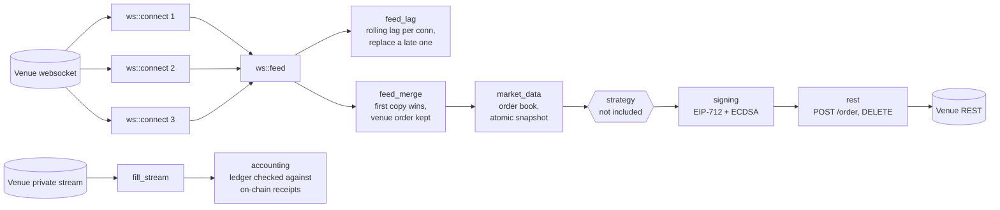

# polymarket-clob-infra

[](https://github.com/38st/polymarket-clob-infra/actions/workflows/ci.yml)
[](https://github.com/38st/polymarket-clob-infra/blob/main/LICENSE)

Infrastructure from a Rust market maker I built for
[Polymarket](https://polymarket.com)'s central limit order book. This crate
holds the parts that are independent of any trading strategy: the order
book, the merge of redundant market-data connections, connection-lag
detection, the websocket and REST transport, EIP-712 order signing, the
private fill stream, and an execution ledger checked against on-chain
receipts. Strategy, risk rules and research are not included.

It is the feed and accounting layer under a bot, not a client library:
[`Polymarket/rs-clob-client`](https://github.com/Polymarket/rs-clob-client)
is the venue's own client, and this crate's `polymarket::rest` is the small
part of a client a market maker needs, kept so the order ID is known before
the POST and a lost answer is never retried with a fresh salt.

## Architecture



## Quickstart

The book, the merge and the signing need no network and no runtime (build
with `--no-default-features` for just those). The transport, the REST client
and the fill stream are behind the `net` feature, on by default, and run on
tokio.

**A book from the venue's messages**, and a decision snapshot that refuses a
passive order which would cross it:

```rust
use polymarket_clob_infra::market_data::{now_ms, MarketData};
use serde_json::json;

# fn main() -> anyhow::Result<()> {
let book = MarketData::default();
book.reset(&["111".into(), "222".into()]);
book.connected();
let now = now_ms().to_string();
book.ingest(&json!({"event_type": "book", "asset_id": "111", "timestamp": now,
    "bids": [{"price": "0.40", "size": "25"}], "asks": [{"price": "0.42", "size": "10"}]}));
book.ingest(&json!({"event_type": "book", "asset_id": "222", "timestamp": now,
    "bids": [{"price": "0.58", "size": "10"}], "asks": [{"price": "0.60", "size": "25"}]}));

// Every token has a book, none is crossed, the stream is alive: one snapshot.
let snapshot = book.snapshot()?;
assert_eq!(snapshot.best_bid("111"), Some(0.40));
assert_eq!(snapshot.depth("222").unwrap().ask_depth_to(600_000), 25.0);
// A post-only BUY joins the decision's bid at most: 0.40 passes, 0.41 (a
// better bid than decided) and 0.42 (crossing) are refused.
assert!(book.validate(&snapshot, "111", "BUY", 0.40, true).is_ok());
assert!(book.validate(&snapshot, "111", "BUY", 0.41, true).is_err());
assert!(book.validate(&snapshot, "111", "BUY", 0.42, true).is_err());
# Ok(()) }
```

**Two connections merged**: each venue event is applied once, from whichever
connection delivers it first, in the venue's order.

```rust
use polymarket_clob_infra::ws::feed_merge::{EventKey, MarketMerge, Step};
use serde_json::json;
use std::time::{Duration, Instant};

let now = Instant::now();
let mut merge = MarketMerge::default();
merge.subscribe(1, now);
merge.subscribe(2, now);
let book = |token: &str| json!({"event_type": "book", "asset_id": token, "timestamp": "1700000000000",
    "hash": "h", "bids": [{"price": "0.40", "size": "25"}], "asks": [{"price": "0.42", "size": "10"}]});
// No connection is in line yet: connection 1's subscription snapshots (token
// 0 and 1) start the market's book, as a single socket would.
assert!(matches!(merge.snapshot(1, 0, &book("111"), now), Step::Apply(_)));
assert!(matches!(merge.snapshot(1, 1, &book("222"), now), Step::Apply(_)));
// Connection 2's are held: it lines up behind the applied history (here on a
// quiet market, by its view being the applied book: `same_view` says so).
assert!(matches!(merge.snapshot(2, 0, &book("111"), now), Step::Held));
merge.snapshot(2, 1, &book("222"), now);
let later = now + Duration::from_millis(1_100);
assert!(merge.tick(later, &|_| true).is_empty()); // nothing held to apply
assert!(merge.in_line(1) && merge.in_line(2));

let change = json!({"event_type": "price_change", "timestamp": "1700000000500", "price_changes": [
    {"asset_id": "111", "side": "BUY", "price": "0.41", "size": "5", "best_bid": "0.41", "best_ask": "0.42"}]});
let key = EventKey::of(&change);
// Connection 2 delivers it first: applied, from it.
assert!(matches!(merge.book_event(2, key, &change, later), Step::Apply(ref list) if list[0].conn == 2));
// Connection 1's copy is a duplicate.
assert_eq!(merge.book_event(1, key, &change, later), Step::Duplicate);
```

**Sign an order** (EIP-712 over the exchange contract's domain) and an L2
request header. The order's hash is the venue's order ID, known before the
order is sent.

```rust
use polymarket_clob_infra::polymarket::signing::{hmac_signature, unsigned_order, Wallet, BUY};

# fn main() -> anyhow::Result<()> {
// The public test key (scalar 1): never trade with it.
let wallet: Wallet = format!("{:064x}", 1).parse()?;
// BUY 5 shares at 40c: 2.000000 USDC for 5.000000 shares, from the proxy wallet (signature type 1).
let order = unsigned_order(&wallet, "12345678901234567890", 2_000_000, 5_000_000, BUY,
    "0x1111111111111111111111111111111111111111", false, 1)?;
let order_id = order.order_id.clone();
let signature = order.sign(&wallet)?;
assert!(order_id.starts_with("0x") && signature.len() == 132);

// The L2 header of an authenticated request: HMAC over timestamp, method, path and body.
let poly_signature = hmac_signature("AA==", "1700000000", "POST", "/order", "{}")?;
assert_eq!(poly_signature.len(), 44);
# Ok(()) }
```

**The feed on the venue** (`net`): three connections, merged, each one
watched and replaced when it stays late.

```rust,no_run
use polymarket_clob_infra::ws::feed::Feed;
use polymarket_clob_infra::ws::feed_lag::FeedSettings;

# async fn run(up: String, down: String) -> anyhow::Result<()> {
let feed = Feed::start(FeedSettings::default(), vec![[up.clone(), down]])?;
tokio::time::sleep(std::time::Duration::from_secs(5)).await;
let snapshot = feed.snapshot()?; // refused while a market has no connection in line
println!("Up {:?} / {:?}", snapshot.best_bid(&up), snapshot.best_ask(&up));
for c in feed.stats().conns {
    println!("connection {}: lag p50 {:?} ms, delivered first {}", c.conn, c.lag_p50, c.first);
}
feed.stop().await;
# Ok(()) }
```

**Place and cancel an order** (`net`):

```rust,no_run
use polymarket_clob_infra::polymarket::auth::derive_api_creds;
use polymarket_clob_infra::polymarket::rest::{ApiCreds, Client, NewOrder, CLOB_URL};
use polymarket_clob_infra::polymarket::signing::{Wallet, BUY};

# async fn run(token: &str, funder: &str) -> anyhow::Result<()> {
let wallet: Wallet = std::env::var("PRIVATE_KEY")?.parse()?;
let (key, secret, passphrase) = derive_api_creds(&reqwest::Client::new(), &wallet, CLOB_URL).await?;
let client = Client::new(CLOB_URL, &wallet, ApiCreds::new(key, secret, passphrase))?;

// 5 shares at 40c, post-only, good till cancelled.
let order = NewOrder::gtc(token, BUY, 2_000_000, 5_000_000, funder).post_only();
let placed = client.place(&wallet, &order).await?; // the ID is known before the POST
println!("{} {}", placed.order_id, placed.status);
let cancelled = client.cancel(&placed.order_id).await?;
assert!(cancelled.cancelled(&placed.order_id) || client.order_closed(&placed.order_id).await?);
# Ok(()) }
```

## What's here

| Module | What it does |
|---|---|
| [`market_data`](src/market_data.rs) | One atomic snapshot of every subscribed book for each decision. Prices are integer millionths, exact for every tick size. Out-of-order and future-dated messages are refused. On a quiet market, books stay current only while the stream proves it is alive. |
| [`ws::feed_merge`](src/ws/feed_merge.rs) | Merges N websocket connections into one book per market. Each venue event is applied once, from whichever connection delivers it first, in the venue's order. A connection is "lined up" against a log of applied events by content key. If two connections disagree about the market's history, the market is rebuilt from a fresh snapshot. |
| [`ws::feed_lag`](src/ws/feed_lag.rs) | Delivery lag per connection over a rolling window (a histogram with quantiles), a check of the local clock against the venue's, and the rules that replace a connection that stays late. |
| [`ws::connect`](src/ws/connect.rs), [`ws::feed`](src/ws/feed.rs) | `net`. One connection (subscribe, pings, every frame with its receive instant), and the feed that runs N of them: opened, merged, watched, replaced when diverged, failed, late or closed, with per-connection numbers. |
| [`ws::fill_stream`](src/ws/fill_stream.rs) | `net`. The private stream's fills and order updates on a channel; a refused login is told apart from an outage. |
| [`polymarket::signing`](src/polymarket/signing.rs), [`abi`](src/abi.rs) | EIP-712 typed-data signing of CLOB orders with secp256k1, checked against the official Python SDK's test vectors. The key's bytes are zeroized on drop. |
| [`polymarket::auth`](src/polymarket/auth.rs), [`polymarket::rest`](src/polymarket/rest.rs) | `net`. L1 (EIP-712) and L2 (HMAC) API authentication; the REST client: place, cancel, cancel-all, cancel by market, order reads, the public book and clock. A refusal is an error with the venue's answer; nothing is retried. |
| [`fees`](src/fees.rs) | The venue's V2 taker fee curve and a conservative collateral reservation for a BUY. An estimate for admission only: the fee paid comes from the receipt. |
| [`accounting`](src/accounting.rs), [`receipts`](src/receipts.rs), [`execution`](src/execution.rs) | A durable record of executions and an average-cost portfolio built from it. A missing fee or settlement stays *unknown* and is never treated as zero. Fills are checked against the on-chain settlement receipts, and settled history is archived. |

## See it run

[`examples/replay.rs`](examples/replay.rs) replays 8 minutes of a recorded
market (36,815 venue messages) over three simulated connections. Each has its
own latency, jitter and slow spell, and one of them skips a book event:

```text
$ cargo run --release --example replay
connection 3 diverged from the applied history: dropped
36815 messages, 3 connections, 480 s of market
                 applied: 36815
      duplicates dropped: 70445
    held while lining up: 11
  connection 1 delivered first: 46.1%
  connection 2 delivered first: 36.9%
  connection 3 delivered first: 17.0%
  merged lead over connection 1 alone: mean 30.0 ms, p99 87.5 ms, max 106.7 ms
  merged lead over connection 2 alone: mean 5.5 ms, p99 122.1 ms, max 147.2 ms
  merged lead over connection 3 alone: mean 8.9 ms, p99 69.2 ms, max 116.4 ms
  merge cost: 1437 ns per delivered message
merged book == single-stream book on both tokens: OK
```

Every venue message is applied exactly once and every copy is dropped. The
connection that skipped an event is caught and dropped the moment its history
disagrees. The final book is identical to the one built from the venue's own
stream. [`tests/merge_prop.rs`](tests/merge_prop.rs) checks the same over
random delays, slow spells, lost prints and venue repeats.

[`examples/live.rs`](examples/live.rs) runs the feed on the venue (public
data; it sends nothing), on the current BTC 5-minute market unless a slug is
given. From a home connection in Europe, 60 seconds, three connections:

```text
$ cargo run --release --example live -- 60
market btc-updown-5m-1793070000: tokens ..614057 / ..885769
3 market-data connection(s); one is replaced when its median lag over 2000 ms stays above 50 ms (with the clock checked within 50 ms of the venue's) or 30 ms above the best other connection's for 3000 ms
[  10 s] applied 4146 dup 8250 held 13 replaced 0 dropped 0 rebuilt 0 | Up 0.090 / 0.100 | Down 0.900 / 0.910 | clock [-56, 72] ms
    conn 1 (slot 0): up 9 s | first 75.5% | window p50 47 ms p90 55 ms (1455 samples) | life p50 47 ms p90 56 ms (4144)
    conn 2 (slot 1): up 9 s | first 5.4% | window p50 50 ms p90 60 ms (1454 samples) | life p50 50 ms p90 66 ms (4129)
    conn 3 (slot 2): up 9 s | first 19.1% | window p50 48 ms p90 58 ms (1454 samples) | life p50 49 ms p90 64 ms (4129)
...
3 connections, 60 s: 11688 applied, 23336 duplicates dropped, 0 replaced, 0 dropped
```

Two thirds of every message are copies; one connection delivers first three
times in four; from this host every connection is about 47 ms behind the
venue's timestamps (the clock check bounds the local clock within [-56, 72]
ms of the venue's, so the absolute limit stays off and only the comparison
between connections applies).

## Design notes and measurements

These come from the module docs, where each is explained in full, and from
[`docs/measurements.md`](docs/measurements.md), which has the data.

- **Why redundant feeds.** Measured over 140 two-minute probe runs from AWS
  Dublin: median delivery lag was 10 ms, but p90 was 62-83 ms and p99 about
  370 ms on a weekday. 3.6% of connections were 79-88 ms late for their whole
  life. A single long-lived socket can sit 80 ms behind without knowing it.
- **Why merge by position.** Two recorders compared over 1.39 M common book
  events delivered them in the same order on every connection, with no swaps.
  Trade prints float against them (2,757 inversions), and the venue repeats
  single messages verbatim (1,105 in 6.5 M events, never three in a row). So
  book events are merged by their position in a shared log, prints are
  counted by copy, and a connection lines up only after 4 consecutive matches.
- **Clock-free comparison.** Comparing two connections' lags needs no clock,
  because the local clock's error cancels out. An absolute lag limit does need
  one, so it applies only while a clock check bounds the offset to about one
  round trip. The check works even though the venue reports whole seconds: it
  times its requests across the venue's second boundaries.
- **Exact money.** Fill and receipt checks work in on-chain integer units.
  The venue rounds each partial fill to whole units, so the tolerance is
  exactly one unit, not a float epsilon.
- **Fail closed.** An invalid setting is an error, never a silent default. A
  missing fee is unknown, never zero. A lost POST answer is reported, never
  retried with a fresh salt. Release builds keep integer-overflow checks on,
  and a test fails if they are ever turned off.

## Benchmarks

`cargo bench` (criterion), Apple M2 Max, release build, per message of the
recorded market (the earlier README listed 172 ns for the book apply: that
benchmark never applied anything, see the changelog):

| Operation | Cost |
|---|---|
| Apply a venue message to the book | 1.2 µs |
| Content key of a feed message | 1.0 µs |
| Merge a message (one connection, including its copy) | 4.8 µs |
| Sign an order (EIP-712 hash + ECDSA) | 56 µs |
| L2 HMAC request signature | 1.3 µs |

## Running

```bash
cargo test --release                     # units, the recorded market, the merge property, local-server feeds, doctests
cargo test --release --no-default-features   # the offline crate alone
cargo run --release --example replay
cargo run --release --example live -- 60 # public data only
cargo bench
```

The tests replay every message of a recorded live market
(`tests/fixtures/recorded_market.jsonl.gz`, public venue data). Signing is
checked against the official SDK's vectors using the public test key `0x…01`.
`examples/order_latency_probe.rs` sends real 1c post-only orders and needs
`PROBE_LIVE_CONFIRM=yes` and a funded wallet; read its header first.

Minimum supported Rust: 1.90 (checked in CI). Features: `net` (default)
pulls tokio, reqwest and tokio-tungstenite; without it the crate is
dependency-light and runtime-free.

## Source and drift

Extracted from the market maker's crate at commit `f11511f` (2026-10-26) and
adapted (self-contained docs, neutral defaults, no strategy hooks). The bot
keeps changing; [`tools/drift.sh`](tools/drift.sh) reports, per module, how
many lines differ from a checkout of it. [`CHANGELOG.md`](CHANGELOG.md) lists
what each release took over. [`SECURITY.md`](SECURITY.md) says what the
crate does with keys and credentials.

## License

MIT
